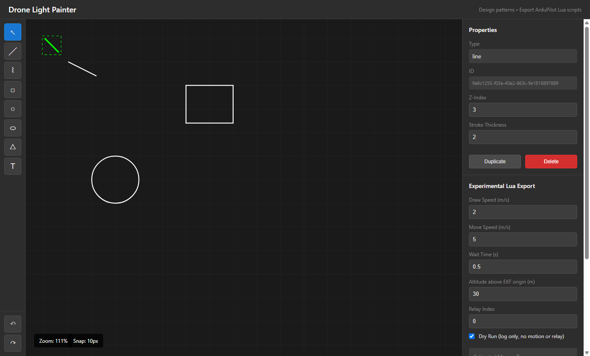

# Drone Light Painter

A local desktop pattern editor for exploring UAV light-painting trajectories. Draw SVG geometry, inspect path checks, estimate traversal time, and export an **experimental ArduCopter Lua controller**. It connects a visual editor to the geometry and state-machine problems behind a drone drawing a pattern.



## What works

- Draw lines, freehand polylines, rectangles, circles, ellipses, triangles, and text.
- Select and drag immediately; Shift-click adds/removes selections. Duplicate or delete from Properties.
- Undo/redo up to 100 edits. A drag is one edit; wheel zoom stays anchored under the pointer. Alt-drag or middle-drag pans.
- Snap drawing points to nearby endpoints and anchors (10 screen pixels by default).
- Convert A-Z and 0-9 text into a simple built-in stroke alphabet. Unsupported characters are rejected; these are hand-defined strokes, not font outlines.
- Inspect geometry/configuration errors and inter-stroke jump warnings. Changing a shape or setting invalidates the previous analysis and export confirmation.
- Estimate path time from actual repositioning distances, draw/move speeds, and per-point waits.
- Download Lua with stroke boundaries preserved and the light off during repositioning. Dry run defaults to **log only**, with no vehicle or relay commands.

## Run from a clean checkout

Windows 10/11 x64 was verified with Node 25.5.0 and npm 11.17.0. Install Node **22.12 or newer, below 26**; Node 24 is suitable for CI. Network access is required for the initial npm/Electron downloads. Exact direct versions and the dependency lockfile are committed.

```powershell
npm ci
npm run test:run
npm run test:desktop
npm start
```

`test:desktop` builds the renderer/main, launches the actual Electron app, exercises drawing/history/zoom/analysis/export invalidation, saves `docs/editor.png`, and exits. It uses software rendering for compatibility with the verification host. First launch may download Electron's runtime. `npm start` opens the desktop application; close its window to exit.

Other commands:

```powershell
npm run dev             # browser editor at http://localhost:5173
npm run electron:dev    # renderer dev server + Electron
npm run build           # TypeScript check + production renderer
npm run build:main      # CommonJS Electron main/preload
npm run electron:build  # unsigned Windows folder in release/verified/win-unpacked
npm audit
```

Rollup uses its official `@rollup/wasm-node` package through an npm alias/override. This avoids a native addon blocked by the verification host's Application Control policy; no system security settings are changed. Keep the alias and lockfile together.

## First design

Choose a tool on the left and drag on the canvas. Text starts as `Text`; select it, edit its content in Properties, then choose **Convert text to strokes**. Pan/zoom changes only the view. Run Safety Analysis, read the issues, and acknowledge the limitations before exporting. Invalid geometry or settings block export even if the export function is called directly.

One canvas unit is **one metre**; the grid is 50 metres. The starter scene demonstrates shapes and produces warnings for gaps between strokes. It is not a recommended flight plan. Designs are kept in memory; there is no project save/load or autosave yet. Export is a Lua download, not a saved editable project.

## Controller contract and limits

**Simulator and flight operation remain UNVERIFIED. Do not treat the output as a validated flight mission.** No ArduPilot SITL or aircraft was available for this run. Lua interpreter tests use mocked APIs and do not model flight physics, firmware integration, or failsafe behavior.

The controller targets Copter GUIDED mode (mode 4), requires an already armed vehicle and an available EKF position, and does not arm, take off, land, or switch modes. Coordinates are North/East metres relative to the EKF origin; altitude is metres **above that origin**, not terrain clearance or necessarily height above home. UI y points down; exported y is East. Operators must establish the coordinate frame and altitude before any simulator integration.

Each point carries whether the incoming move is a drawing stroke. A new stroke's first point is a light-off reposition. The controller applies proportional velocity toward the point, capped at draw/move speed, waits within a 0.2 m radius for the configured per-point interval, then advances. A point times out after 120 seconds. Missing position, disarm/mode loss, or command rejection stops the script and turns the light off. In GUIDED mode it requests zero velocity on stopping. It never resumes automatically after an abort. These are software behaviors tested with mocks, not an aircraft safety certification.

Checks do not cover obstacles, airspace, terrain, wind, battery endurance, path intersections, controller tracking quality, relay wiring, or firmware-specific limits. Time estimates exclude travel to the first point, takeoff/landing, acceleration and wind; the 1.5x range is a heuristic, not a measured confidence interval. Curves use 64 straight edges. Polyline drawing samples mouse motion rather than click-to-add vertices. Shape selection uses bounding boxes.

API references checked during implementation: [ArduPilot Lua guide](https://ardupilot.org/dev/docs/common-lua-scripts.html), [generated binding definitions](https://github.com/ArduPilot/ardupilot/blob/master/libraries/AP_Scripting/docs/docs.lua), and [GUIDED coordinate frames](https://ardupilot.org/dev/docs/copter-commands-in-guided-mode.html). Check the bindings for the actual simulator/firmware version before integration.

## Design decisions and verification

React + TypeScript render SVG; Zustand holds document and selection state. Pure geometry, snapping, validation, time estimation and Lua export modules live separately under `src/renderer`. `src/main` owns a minimal Electron window with context isolation and no Node integration. It exposes no privileged IPC bridge.

The difficult boundary is turning visible strokes into ordered controller moves without lighting the gaps. The earlier exporter mixed canvas metres with latitude/longitude and used an unsupported call signature. The revised exporter uses local NED position feedback and explicit incoming-stroke flags. Tests execute its Lua in Fengari (Lua 5.3) to check completion, wait timing, light-off transitions, dry runs, timeouts and aborts. Other regression tests check history restoration, drag grouping, snapping, non-finite inputs and connected-stroke timing. `validateLuaScript` is only a legacy structural lint; interpreter execution provides the stronger syntax/behavior check.

Local verification and packaging results are recorded in [docs/verification.md](docs/verification.md). GitHub Actions reruns clean install, builds, unit tests and desktop smoke on Windows; an added workflow is not a claim that remote CI has already run.

MIT licensed; see [LICENSE](LICENSE).
